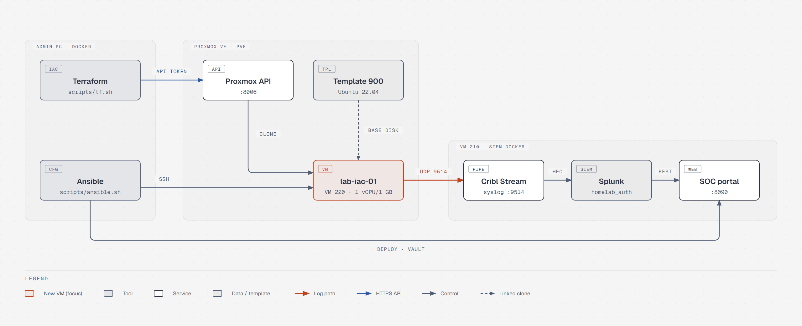
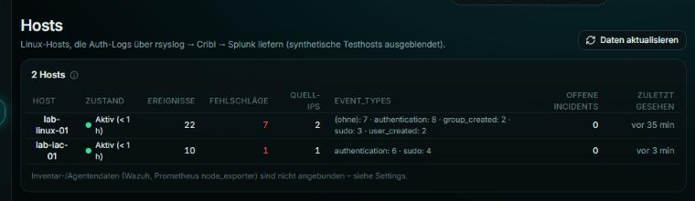
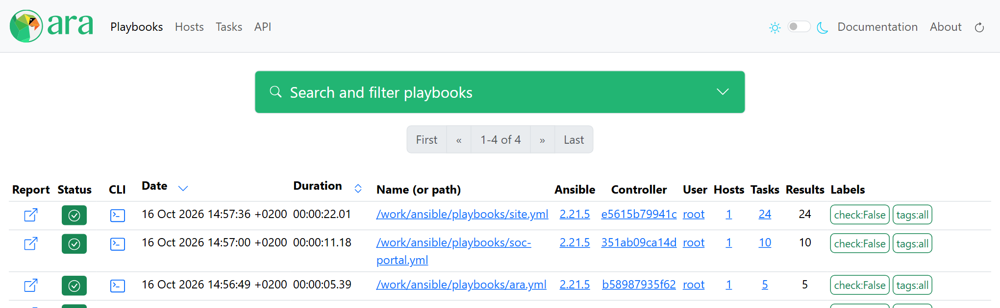

# homelab-infrastructure-automation

[Deutsche Version](README.md)

For a long time I clicked my Proxmox VMs together in the web UI and then set them up by hand over SSH. By the
third time I no longer knew exactly which packages, firewall rules and rsyslog lines had ended up on which
machine. With this repository I now build the homelab reproducibly: Terraform creates the VMs, Ansible sets
them up, and GitHub Actions checks every push.

My favourite effect: every new VM ships its auth logs to my
[homelab SIEM](https://github.com/QuitScope/homelab-siem) on its own and shows up in the
[SOC portal](https://github.com/QuitScope/homelab-soc-portal) without any extra step.





## What's inside

| Area | Content |
|---|---|
| `terraform/` | one VM as a linked clone of my Ubuntu template, 1 vCPU / 1 GB, cloud-init with DHCP and SSH key |
| `ansible/roles/base` | admin user with key, SSH hardening, ufw, fail2ban, automatic security updates |
| `ansible/roles/docker` | Docker Engine and Compose plugin from the official repository |
| `ansible/roles/rsyslog_cribl` | sends `auth,authpriv` to Cribl at `<VM-IP>:9514` |
| `ansible/roles/soc_portal` | rolls out the SOC portal on siem-docker, the `.env` comes from HashiCorp Vault |
| `ansible/roles/ara` | ARA as a dashboard that records every Ansible run |
| `ansible/roles/vault` + `terraform/vault` | HashiCorp Vault: operated with Ansible, configured with Terraform |
| `scripts/` | wrappers that start Terraform and Ansible in containers, and `vm-ip.sh` |
| `.github/workflows/ci.yml` | `terraform fmt`/`validate`, `yamllint`, `ansible-lint`, `--syntax-check` |

## Why it is built this way

- **Terraform and Ansible in containers:** my workstation runs Windows, where Ansible is not available natively.
  Instead of setting up WSL, both tools run in Docker through `scripts/tf.sh` and `scripts/ansible.sh`, with the
  same versions as in CI.
- **Small linked clones:** the Proxmox host has four cores and hardly any free RAM. A test VM therefore gets
  1 vCPU and 1 GB and shares its base disk with the template. After the full Ansible run it takes about 3 GB
  instead of 32 GB.
- **Monitoring from the first boot:** the `rsyslog_cribl` role is part of the standard playbook. A VM that does
  not show up in the SIEM does not count as finished for me.
- **ARA instead of AWX:** AWX would need Kubernetes and several GB of RAM the host does not have. ARA is a single
  container and still shows every run with all tasks, `changed`/`ok` and duration.
- **HashiCorp Vault for secrets:** I did not want credentials spread across `.env` files on several machines.
  Vault runs as a container on siem-docker; Terraform and Ansible fetch their secrets from it at runtime, each
  with its own AppRole and access only to what it needs.

The full reasoning behind each decision is in [docs/architecture.en.md](docs/architecture.en.md).

## Quick start

Requirements: Docker, Bash (Git Bash on Windows) and an SSH key `~/.ssh/id_ed25519` with root access to the
Proxmox host. Terraform and Ansible do not need to be installed.

```bash
cp .env.example .env          # Proxmox endpoint and Vault address, see docs/operations.en.md
scripts/tf.sh init
scripts/tf.sh apply
export LAB_VM_IP=$(scripts/vm-ip.sh)
scripts/ansible.sh ansible-playbook playbooks/site.yml
```

A second run of the playbook has to show `changed=0`, otherwise a role is not idempotent. Clean up with
`scripts/tf.sh destroy`.

The SOC portal, ARA and Vault on siem-docker are rolled out with their own playbooks, for example
`scripts/ansible.sh ansible-playbook playbooks/soc-portal.yml`. For that, `.env` needs the AppRole credentials
for Vault, see [docs/operations.en.md](docs/operations.en.md#hashicorp-vault). Every run through
`scripts/ansible.sh` is recorded in ARA at `http://<VM-IP>:8091`.



## What went wrong and what I learned

- **The API token was not allowed to do anything.** The first `terraform apply` ended with
  `403 Permission check failed`. The token was created with privilege separation and then does not inherit the
  user's permissions. The role is now attached to the token itself, which is cleaner anyway because I can revoke
  the token independently of the user.
- **My playbook was not idempotent.** The second run showed `changed=1` for fail2ban. The cause: the template has
  no rsyslog, so on the first run there was no `/var/log/auth.log` yet and fail2ban crashed. The sshd jail now
  reads from journald. Without the `changed=0` check I would never have noticed.
- **A fixed MAC does not mean a fixed IP.** After `destroy` and `apply` the FritzBox handed out a new address
  despite the same MAC. `vm-ip.sh` therefore looks it up every time in the Proxmox host's ARP table, because the
  template has no guest agent that could report it.
- **Windows files in a Linux container:** mounted Windows folders show up in the container with mode `0777`. SSH
  then refuses the key, Ansible ignores `ansible.cfg` in such a directory and would even have executed the vault
  password file as a script. The wrapper therefore copies these files into the container with proper modes.
- **ARA needed more memory than expected.** With a 256 MB limit the container sat at 188 MB right after start.
  The limit is now 384 MB.
- **The token nearly ended up in the state.** The first version read the Proxmox token from Vault as a data
  source, which put it into the Terraform state. The provider itself had marked that as deprecated. With an
  ephemeral resource the value is only read at runtime.

Every run with its actual output is in the [test protocol](docs/test-protocol.en.md).

## Addresses

The docs use placeholders instead of fixed IPs: `<VM-IP>` is the VM `siem-docker` running Splunk, Cribl, the
portal, ARA and Vault, `<LAB-VM-IP>` the test VM created by Terraform, and `<PROXMOX-IP>` the Proxmox host. The
real addresses are in the inventory (`ansible/inventory/hosts.yml`), the role defaults and `.env`.

## Documentation

- [docs/architecture.en.md](docs/architecture.en.md): layout, data flow, decisions
- [docs/operations.en.md](docs/operations.en.md): setup, operations, updates, recovery, secrets
- [docs/test-protocol.en.md](docs/test-protocol.en.md): real runs with their results

## Secrets

Secrets are managed centrally in HashiCorp Vault. Terraform fetches the Proxmox API token at runtime through its
own AppRole, Ansible reads the portal configuration through `community.hashi_vault`. Each AppRole can only reach
its own secret, and every access is recorded in the audit log. Vault's own unseal key and root token are
protected with Ansible Vault; its password is kept locally in `.vault_pass`. Details are in
[docs/operations.en.md](docs/operations.en.md#hashicorp-vault).
