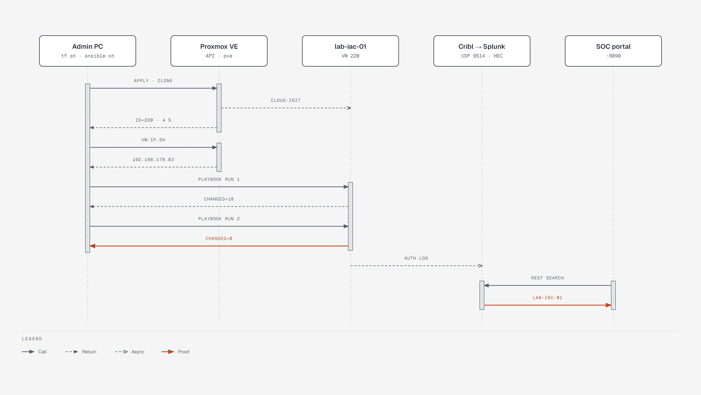

# Architecture

*[Deutsche Version](architecture.md)*

## Overview


Source: [diagrams/architecture.en.html](diagrams/architecture.en.html), generated with [diagrams/generate.py](diagrams/generate.py). GitHub CI and the ARA dashboard (also on siem-docker, port 8091) are deliberately left out, see [`.github/workflows/ci.yml`](../.github/workflows/ci.yml) and [operations.en.md](operations.en.md#ara-dashboard).

## Flow



Source: [diagrams/sequence.en.html](diagrams/sequence.en.html). The values come from the [test protocol](test-protocol.en.md).

1. Terraform talks to the Proxmox API with a token that has its own minimal role (`TerraformProv`).
   It clones template 900 as a linked clone: the VM shares the template's base disk, only changed
   blocks take space on `local-lvm`. After the full Ansible run that was about 3 GB of a nominal 32 GB.
2. cloud-init sets the hostname (= VM name), DHCP and the SSH key for `root`.
3. Ansible waits for SSH and for `cloud-init status --wait`, because apt otherwise fails on the
   dpkg lock. Then three roles run:
   - `base`: baseline hardening, admin user, firewall, updates
   - `docker`: container runtime
   - `rsyslog_cribl`: log forwarding
4. rsyslog sends `auth`/`authpriv` over UDP to Cribl. Cribl normalises the events and writes them to
   Splunk over HEC. The SOC portal derives its host list from `index=homelab_auth`, so every VM
   configured this way shows up under Hosts and in the topology on its own.

## Design decisions

| Decision | Reason |
|---|---|
| Tools in containers instead of local installs | Windows admin PC without native Ansible; same versions as CI (`ansible/requirements.txt`, Terraform 1.16.6) |
| Linked clone, 1 vCPU / 1 GB | Host has 4 cores and little free RAM, the thin pool is overcommitted |
| Guest agent off, `stop_on_destroy` | The template has no running qemu-guest-agent; Terraform would otherwise wait for it and could not shut down cleanly on destroy |
| DHCP + fixed MAC + `vm-ip.sh` | No changes to the FritzBox needed. The IP is found with a ping sweep from the host and its ARP table, because Proxmox does not know it without the agent |
| Token ACL instead of user ACL | The token has privilege separation on and gets the role directly. It can be revoked independently of the user |
| `PermitRootLogin prohibit-password` | Root stays reachable by key for bootstrapping. Next step: Ansible as `ops` and `no` |
| fail2ban with `backend = systemd` | The template has no rsyslog. Without the journald backend `/var/log/auth.log` is missing on the first run, fail2ban crashes and the second run is not idempotent (see test protocol) |
| ARA as the Ansible dashboard, not AWX | AWX (upstream of Ansible Automation Platform) needs Kubernetes and realistically 6–8 GB RAM that the host does not have. ARA is one container with SQLite (~215 MB) and records every run through a callback plugin. Semaphore UI would be the lightweight option if playbooks should also start with a click |
| Portal deployment with role `soc_portal` only | siem-docker deliberately does not get role `base`: ufw with deny incoming would cut off Splunk HEC, Cribl and Splunk Web |
| Portal code via git checkout with a deploy key | Read-only key for this one repository only; `version` is a branch, tag or commit and therefore also the rollback lever. The image is only rebuilt when the checkout changes |
| HashiCorp Vault for runtime secrets | One place for secrets with per-consumer policies, short-lived tokens and an audit log. Raft storage, one container (~26 MB RAM). Configuration as Terraform code (`terraform/vault`); secret values are deliberately not in Terraform because they would end up in the state |
| Ephemeral resource for the Proxmox token | The value is read during `plan`/`apply` and never written to the state (checked: 0 hits in the state). The older data source `vault_kv_secret_v2` is deprecated in provider 5.x and would store the token |
| One AppRole per consumer | `terraform` only reads `homelab/proxmox`, `ansible` only `homelab/soc-portal`; crossing over ends in 403 (tested) |
| Ansible Vault only for the unseal key and root token | Chicken-and-egg: what Vault needs to start cannot live in Vault. The rest of the former Ansible Vault file (portal `.env`) moved into Vault; the role still writes the `.env` byte for byte with `no_log` |
| Docker repository as a `.list` file | `deb822_repository` needs `python3-debian` on the target; the plain file is simpler and just as idempotent |

## Proxmox role `TerraformProv`

```
VM.Allocate VM.Clone VM.Audit VM.PowerMgmt VM.GuestAgent.Audit
VM.Config.CDROM VM.Config.CPU VM.Config.Cloudinit VM.Config.Disk
VM.Config.HWType VM.Config.Memory VM.Config.Network VM.Config.Options
Datastore.AllocateSpace Datastore.Audit SDN.Use Sys.Audit
```

No `Sys.Modify`, no `Permissions.Modify`, no access to users or storage configuration.

## Known limits

- Terraform state is local (`terraform/terraform.tfstate`, git-ignored). Team use needs a remote
  backend with locking (e.g. S3-compatible on MinIO, or Terraform Cloud).
- Ports published by Docker bypass ufw (Docker writes its own iptables rules). This VM has no service
  with a published port yet; use the `DOCKER-USER` chain when needed.
- Syslog over UDP is unencrypted and has no delivery guarantee. For production: RELP or TCP+TLS.
