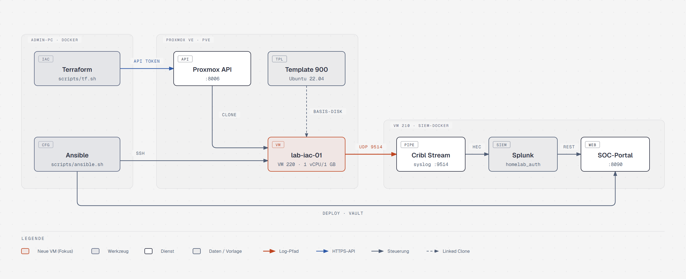
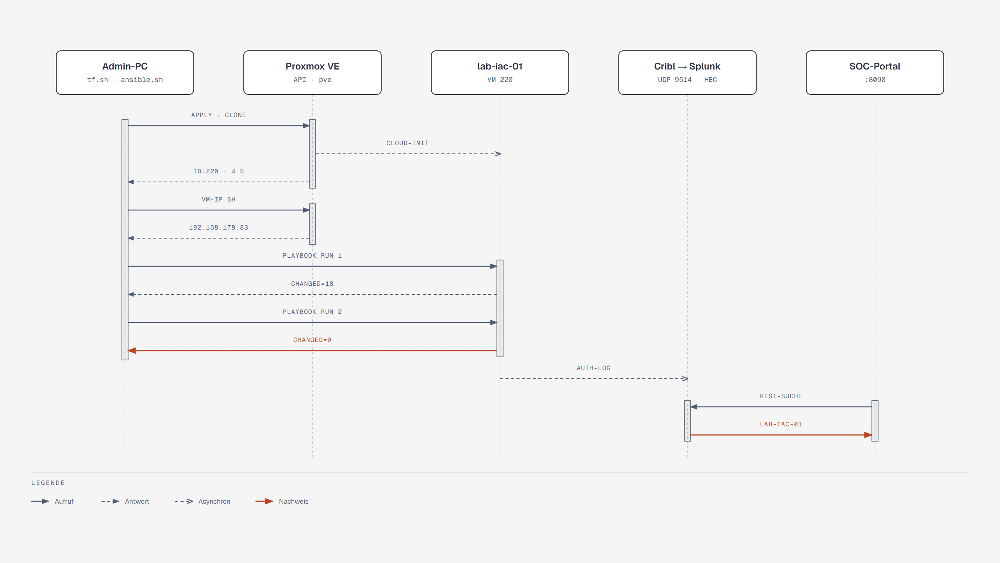

# Architektur

*[English version](architecture.en.md)*

## Überblick



Quelle: [diagrams/architecture.html](diagrams/architecture.html), erzeugt mit [diagrams/generate.py](diagrams/generate.py). GitHub CI und das ARA-Dashboard (ebenfalls auf siem-docker, Port 8091) sind bewusst nicht eingezeichnet, siehe [`.github/workflows/ci.yml`](../.github/workflows/ci.yml) und [operations.md](operations.md#ara-dashboard).

## Ablauf



Quelle: [diagrams/sequence.html](diagrams/sequence.html). Die Werte stammen aus dem [Testprotokoll](test-protocol.md).

1. Terraform spricht mit der Proxmox-API über einen Token mit eigener minimaler Rolle
   (`TerraformProv`). Es klont Template 900 als Linked Clone: Die VM teilt sich die Basis-Disk mit
   dem Template, nur geänderte Blöcke belegen Platz auf `local-lvm`. Nach dem kompletten
   Ansible-Lauf waren das rund 3 GB von nominell 32 GB.
2. cloud-init setzt Hostname (= VM-Name), DHCP und den SSH-Key für `root`.
3. Ansible wartet auf SSH und auf `cloud-init status --wait`, weil apt sonst am dpkg-Lock scheitert.
   Danach laufen drei Rollen:
   - `base`: Grundhärtung, Admin-User, Firewall, Updates
   - `docker`: Container-Laufzeit
   - `rsyslog_cribl`: Log-Weiterleitung
4. rsyslog schickt `auth`/`authpriv` per UDP an Cribl. Cribl normalisiert und schreibt per HEC nach
   Splunk. Das SOC-Portal leitet seine Host-Liste aus `index=homelab_auth` ab, deshalb erscheint jede
   so konfigurierte VM automatisch unter Hosts und in der Topologie.

## Designentscheidungen

| Entscheidung | Begründung |
|---|---|
| Tools in Containern statt lokaler Installation | Windows-Admin-PC ohne natives Ansible; dieselben Versionen wie in der CI (`ansible/requirements.txt`, Terraform 1.16.6) |
| Linked Clone, 1 vCPU / 1 GB | Host hat 4 Kerne und wenig freien RAM, der Thin-Pool ist überbucht |
| Guest-Agent aus, `stop_on_destroy` | Template hat keinen laufenden qemu-guest-agent; Terraform würde sonst auf ihn warten und beim Destroy nicht sauber herunterfahren können |
| DHCP + feste MAC + `vm-ip.sh` | Kein Eingriff in die FritzBox nötig. Die IP wird per Ping-Sweep vom Host und ARP-Tabelle ermittelt, weil Proxmox sie ohne Agent nicht kennt |
| Token-ACL statt User-ACL | Der Token hat Privilege Separation an und bekommt die Rolle direkt. So lässt er sich unabhängig vom User widerrufen |
| `PermitRootLogin prohibit-password` | Root bleibt per Key für den Bootstrap erreichbar. Nächster Schritt: Ansible als `ops` und `no` |
| fail2ban mit `backend = systemd` | Das Template hat kein rsyslog. Ohne journald-Backend fehlt beim ersten Lauf `/var/log/auth.log`, fail2ban stürzt ab und der zweite Lauf ist nicht idempotent (siehe Testprotokoll) |
| ARA als Ansible-Dashboard, nicht AWX | AWX (Upstream der Ansible Automation Platform) braucht Kubernetes und realistisch 6–8 GB RAM, die der Host nicht hat. ARA ist ein Container mit SQLite (~215 MB) und zeichnet jeden Lauf über ein Callback-Plugin auf. Semaphore UI wäre die schlanke Option, falls Playbooks auch per Klick starten sollen |
| Portal-Deployment nur mit Rolle `soc_portal` | siem-docker bekommt bewusst nicht die Rolle `base`: ufw mit deny incoming würde Splunk-HEC, Cribl und Splunk-Web abschneiden |
| Portal-Code per Git-Checkout mit Deploy-Key | Read-only-Key nur für dieses eine Repo; `version` ist Branch, Tag oder Commit und damit auch der Rollback-Hebel. Neu gebaut wird nur, wenn sich der Checkout ändert |
| HashiCorp Vault für Laufzeit-Secrets | Ein Ort für Secrets mit Policies pro Verbraucher, kurzlebigen Tokens und Audit-Log. Raft-Storage, ein Container (~26 MB RAM). Konfiguration als Terraform-Code (`terraform/vault`), Secret-Werte bewusst nicht in Terraform, weil sie sonst im State landen |
| Ephemeral resource für den Proxmox-Token | Der Wert wird bei `plan`/`apply` gelesen und nie in den State geschrieben (geprüft: 0 Treffer im State). Die ältere Datenquelle `vault_kv_secret_v2` ist im Provider 5.x deprecated und würde den Token speichern |
| AppRole pro Verbraucher | `terraform` liest nur `homelab/proxmox`, `ansible` nur `homelab/soc-portal`; ein Zugriff über Kreuz endet mit 403 (getestet) |
| Ansible Vault nur noch für Unseal-Key und Root-Token | Henne-Ei-Problem: Was Vault zum Starten braucht, kann nicht in Vault liegen. Der Rest der früheren Ansible-Vault-Datei (Portal-`.env`) ist nach Vault umgezogen; die Rolle schreibt die `.env` weiterhin byte-genau mit `no_log` |
| Docker-Repo als `.list`-Datei | `deb822_repository` braucht `python3-debian` auf dem Ziel; die Datei ist einfacher und genauso idempotent |

## Proxmox-Rolle `TerraformProv`

```
VM.Allocate VM.Clone VM.Audit VM.PowerMgmt VM.GuestAgent.Audit
VM.Config.CDROM VM.Config.CPU VM.Config.Cloudinit VM.Config.Disk
VM.Config.HWType VM.Config.Memory VM.Config.Network VM.Config.Options
Datastore.AllocateSpace Datastore.Audit SDN.Use Sys.Audit
```

Kein `Sys.Modify`, kein `Permissions.Modify`, kein Zugriff auf Benutzer oder Storage-Konfiguration.

## Bekannte Grenzen

- Terraform-State liegt lokal (`terraform/terraform.tfstate`, git-ignoriert). Für Teamarbeit wäre ein
  Remote-Backend mit Locking nötig (z. B. S3-kompatibel auf MinIO oder Terraform Cloud).
- Docker veröffentlichte Ports umgehen ufw (Docker schreibt eigene iptables-Regeln). Auf dieser VM
  läuft noch kein Dienst mit veröffentlichtem Port; bei Bedarf `DOCKER-USER`-Chain nutzen.
- Syslog per UDP ist unverschlüsselt und ohne Zustellgarantie. Für Produktion: RELP oder TCP+TLS.
